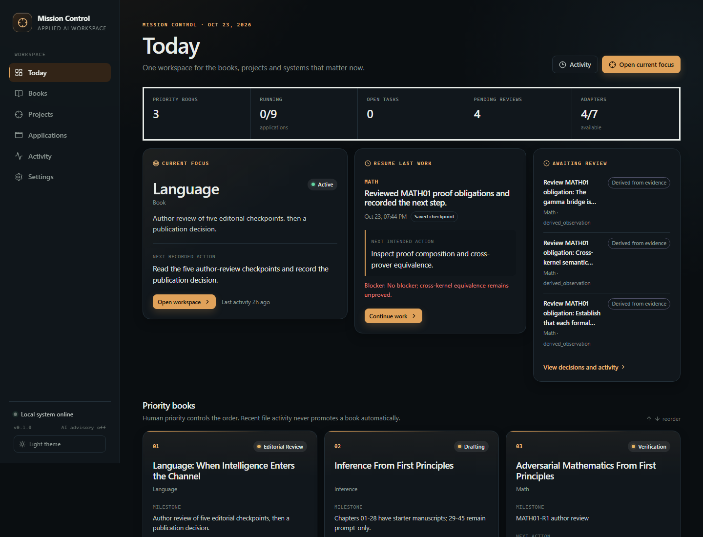

# Mission Control

Mission Control is a local-first control centre for an existing ecosystem of AI applications, books, research programmes and commercial projects. It does not replace those systems. It coordinates them: what matters today, where work stopped, which evidence exists, what can be launched safely, and what should happen next.



## What is implemented

- **Three priority books** — Language, Inference and Math — with persistent workspaces, next actions, priorities and checkpoints.
- **A real application registry** — add or edit applications in the UI, including structured launch definitions, monitoring, documentation actions and relationships. No code change is required.
- **Windows process control** — launch stored commands without a shell, capture logs, stop only Mission Control-owned process trees, detect port conflicts, and reattach to detached servers after a backend restart.
- **Daily continuity** — project focus, checkpoints, tasks, decisions, activity and a resume card based on the latest saved checkpoint.
- **Read-only discovery** — bounded scans of `C:\Projects` and `C:\books`, classification with evidence, exclusions, cancellation and persisted candidates. Discovery never enables a launch command.
- **Evidence adapters** — Language, Inference, Math, Next (local SQLite snapshot), CoCoder review artifacts and Worker health. Unavailable integrations are shown as unavailable; they are not filled with sample data.
- **Grounded daily briefing** — deterministic by default. Optional OpenAI-compatible AI interpretation only after explicit configuration, consent and request. AI remains advisory.
- **Local API and OpenAPI docs** — FastAPI at `/api/*` and `/docs`.

## Requirements

Tested on Windows 11 with:

- Python **3.13** (3.12 or newer required)
- Node.js **25** used and tested on this machine. Node 24 LTS is recommended. `npm install` may print engine warnings from the dev-only vitest/jsdom packages on Node 25; the test suite and production build still pass.
- npm 11
- PowerShell 5.1 or PowerShell 7+
- Git on `PATH` for read-only repository observation

No Docker, Kubernetes, hosted database or cloud service is required. PostgreSQL is not used by Mission Control.

## Install

From PowerShell in the repository root:

```powershell
.\scripts\setup.ps1
```

If script execution is disabled:

```powershell
powershell -ExecutionPolicy Bypass -File .\scripts\setup.ps1
```

The script creates `.venv`, installs the backend in editable mode with test dependencies, installs frontend packages, and builds the production frontend. It uses `uv pip` when uv created the environment (uv virtual environments do not contain pip) and stops on a failed native install/build instead of reporting a false success.

## Start

```powershell
.\scripts\start.ps1
```

URL: **http://127.0.0.1:8790**

The script verifies dependencies, rebuilds the frontend if `frontend/dist` is missing, starts the backend on loopback, and opens the URL.

For frontend development:

```powershell
.\scripts\dev.ps1
```

That starts the API on port 8790 and Vite on http://127.0.0.1:5173. The Vite proxy forwards `/api` to the backend.

## Stop

Press `Ctrl+C` in the window running `start.ps1`.

Or, from another PowerShell window:

```powershell
.\scripts\stop.ps1
```

`stop.ps1` refuses to stop a process on port 8790 unless its command line looks like Mission Control.

**Managed application processes are intentionally left running when Mission Control stops.** They are launched detached so that a backend restart does not kill a server. Mission Control reattaches to owned processes on the next start using the recorded PID and process creation time. Use the Applications page to stop them explicitly.

## First use

1. Open **Today**.
2. Choose a priority book or project, or open its workspace and press **Set focus**.
3. In a project workspace, save a checkpoint with a summary and next action.
4. Open **Applications** to launch configured tools or register new ones.
5. Open **Settings** to configure an editor, add discovery roots, manage exclusions and optionally configure AI.

The Home screen shows:

- current human-selected focus;
- the most recent checkpoint from any project, clearly attributed to that project;
- pending adapter recommendations;
- pinned priority books in user-defined order;
- pinned core applications with real runtime state;
- recent activity and supported outcomes.

## Everyday use

**Open a priority book**
1. Click **Books** in the navigation, or **Open** on a book card on Today.
2. Select Language, Inference or Math in the left rail.
3. The workspace shows the user-maintained status, milestone, next action, checkpoint and manuscript paths.

**Add an application**
1. Open **Applications → Add application**.
2. Fill identity and paths, then add a launch definition.
3. Enable it only after you have verified the command yourself.
4. Save. The new application appears without restarting Mission Control.

**Launch a tool**
1. Open **Applications** (or a pinned app on Today).
2. Press **Launch**. If the control policy requires confirmation, confirm the native dialog.
3. The status becomes Running and the process appears in the managed process table.
4. Press **Logs** for output or **Stop** to terminate the owned process tree.

**Save a next action and resume**
1. Open a project workspace.
2. Under **Checkpoint and resume**, expand **Save a new checkpoint**.
3. Enter what happened, the next intended action and optional blockers/evidence; save.
4. The project becomes the current focus. The Home resume card shows the latest checkpoint across all projects.
5. After restarting Mission Control, open the project or press **Continue work** on Today.

## Data storage, backup and reset

Default local data:

```text
data/
  mission_control.db      SQLite database (registry, continuity, activity)
  logs/
    mission-control.log   Rotating application log
    proc-*.log            Managed process output, redacted on read
```

The directory is git-ignored. Override it with `MISSION_CONTROL_DATA_DIR`.

**Backup:** stop the backend, then copy the entire `data` directory. Process reattachment is not guaranteed if you move the database to another machine.

**Reset user configuration and history:** stop the backend, stop managed applications, rename or delete `data`, then start Mission Control again. Shipped defaults under `config/defaults` are re-seeded. No other repository is touched.

## Configuration precedence

1. **Shipped YAML defaults** in `config/defaults/` are inserted only when an ID does not exist.
2. **Discovery metadata** updates repository observation fields and candidate classification.
3. **User edits in the registry and settings are stored in SQLite and always win.** Re-running discovery or restarting never overwrites priority, pinning, names, launch definitions or notes.

The YAML files are defaults, not a live configuration source. To change a seeded application, use the UI or API. This prevents a future release's default file from silently undoing user work.

## Adding an application

In **Applications → Add application**:

1. Give it a name, category and optional repository/documentation paths.
2. Add a **launch definition**:
   - **Command** for a bounded CLI action.
   - **Server** for a long-running process.
   - **URL only** for an already-running web interface.
3. Set an executable (native `.exe`, or a command resolvable on `PATH`), an argument array, working directory, and optional health check.
4. Mark it **Verified** only after you have run the command yourself and confirmed it starts the intended system.
5. Enable the definition. A launch request uses only the stored definition; it can never supply an executable, working directory or shell command from the browser.

Example registry shape (illustrative only — not a claimed working command for your machine):

```yaml
id: example-tool
name: Example Tool
category: supporting
repository: 'C:\Projects\example'
enabled: true
pinned: false
launch:
  type: command
  working_directory: 'C:\Projects\example'
  executable: 'C:\Tools\example.exe'
  arguments: ['--help']
  enabled: false
  verified: false
  verification_note: 'Replace this example after verifying the real command.'
monitoring:
  type: none
integration:
  adapter: null
  enabled: false
```

The default registry intentionally contains no invented launch commands. Work and Worker definitions are disabled and unverified until you choose to configure them.

### Windows launch rules

- `shell=False` always. Argument arrays are passed directly.
- `.cmd`, `.bat` and `.ps1` files are rejected as launch executables. Configure the native executable instead.
- Paths may contain spaces; they are passed as structured arguments.
- Environment variables are copied only from an allowlist (Windows essentials) plus explicitly named variables in the launch definition. The full parent environment, including unrelated credentials, is not inherited.
- Health checks only run for **enabled** definitions. A responding port does not prove that the configured application owns it; external findings are labelled accordingly.
- Mission Control will not stop an externally detected listener or a process it did not launch.

## Adding a project or book

**Projects → Add project** supports a project kind, description, milestone, next action, one primary repository path and optional book title.

For a book project, Mission Control also creates a book workspace. Book status, milestone, next action, quality review state and URLs are user-maintained until a verified Writer/BookBuilder integration exists. Git activity is never treated as completion evidence.

## Priorities and ordering

Priority is always human-controlled.

- Use the up/down controls on **Today** or **Books** to reorder books.
- Use **Projects** up/down controls to reorder all projects.
- Pin or unpin a project in its workspace or in the projects list.
- Ordering and pin state are persisted in SQLite and survive restarts.
- Discovery never promotes a repository because it was recently modified.

## Checkpoints and resume

A checkpoint records:

- what happened;
- the last completed action;
- the next intended action;
- blockers;
- evidence references;
- an optional milestone.

Saving a checkpoint makes that project the current focus, updates its next action, and survives backend restarts. The Home resume card is based on the **latest checkpoint across all projects**, not just the selected focus, so changing focus does not hide where work actually stopped.

## Status meanings

- **Running** — a managed child is alive, or an enabled health endpoint currently responds.
- **Running (external)** — an endpoint responds, but Mission Control does not own it. A responding port does not prove application identity.
- **Stopped** — a launch action exists; no managed process is running.
- **Unavailable** — no verified/configured capability, or a health probe failed.
- **Misconfigured** — an enabled definition has a missing executable, working directory or health URL.
- **Not checked** — health history has not been collected.
- **Stale** — the last observation is older than its freshness window.
- **Launch failed** — the most recent attempt failed; inspect the failure detail and log.

User-entered state (book status, next action, focus) and observed state (process, Git, adapter evidence) are stored separately.

## Editor configuration

Mission Control never assumes an editor path. Configure a **native** executable in Settings, for example:

```text
C:\Users\<you>\AppData\Local\Programs\Microsoft VS Code\Code.exe
```

`code.cmd` is rejected because the launcher is a shell script. With no valid editor configured, repository buttons are disabled and explain why.

## Integrations and adapters

Adapters are read-only and independent. Each records source, timestamp and evidence.

| Integration | State | What it reads |
| --- | --- | --- |
| Language book | Verified | `content/books/language` chapter files and `planning/STATUS.md` |
| Inference book | Verified | `C:\books\inference` chapter files and the README's dated status claim |
| Math book | Verified | `artifacts/math01/report.json` assessments, capabilities and unresolved obligations |
| Next | Verified snapshot | Configured local SQLite `data/next.db` opportunity rows; labelled a snapshot, not a PostgreSQL/production view |
| CoCoder | Requires artifact | A `cocoder review --format json --output FILE` artifact whose path is configured |
| Worker | Verified endpoint | `GET /health` only; never submits work |
| Work | Blocked | No verified read-only opportunity export configured; no opportunities are fabricated |
| Writer / Improve / BookBuilder / Stephanie / Workbench | Not integrated | Repository/documentation access only; build and launch actions remain disabled until verified |

Adapters fail in isolation. An unavailable adapter, timeout or malformed artifact produces an unavailable status and diagnostics, not a dashboard failure.

## Optional AI integration

AI is disabled by default and requires:

1. `ai.enabled = true`;
2. explicit `ai.consent = true`;
3. an OpenAI-compatible base URL and model;
4. the API key, if needed, in the named environment variable (for example `OPENAI_API_KEY`).

API keys are never stored in SQLite, returned by the API or logged. The key name — not the value — is configuration.

The deterministic briefing always works. If the provider is offline or fails, the deterministic briefing is retained and the failure is reported. AI can only summarise, compare and recommend. It cannot launch tools, modify repositories, publish, submit applications or spend money. AI suggestions retain evidence references and never overwrite human priorities.

## API

- OpenAPI UI: http://127.0.0.1:8790/docs
- OpenAPI JSON: http://127.0.0.1:8790/openapi.json
- Health: http://127.0.0.1:8790/api/health

Browser-originated state-changing requests must come from an allowlisted local origin and include `X-Mission-Control-Request: 1`. The backend binds to loopback only and rejects non-local hosts at startup. Launch requests accept only a launch definition ID and confirmation flag — never an executable or shell command.

## Tests

```powershell
.\scripts\test.ps1
```

Or directly:

```powershell
.venv\Scripts\ruff.exe check backend scripts
.venv\Scripts\python.exe -m pytest -q
cd frontend
npm test
npm run build
```

Current result: **43 backend tests passing, 9 frontend tests passing, production build succeeds.** The suite includes real local process launch/stop/log capture, a backend restart reattachment test, real configured-editor invocation, discovery exclusions, migrations, checkpoint persistence, adapter failure isolation, origin/security checks and secret redaction.

## Troubleshooting

**Application will not launch**
- Open the application's failure line and **Logs**.
- Check the executable resolves on `PATH` or is an absolute native executable.
- Check working directory exists.
- `.cmd`, `.bat` and `.ps1` launchers are rejected by design; point to the native executable.
- If the expected port is already in use, Mission Control refuses to claim or stop the foreign listener.

**Repository button is disabled**
- Configure a native editor executable in Settings.
- The button title/why-actions panel gives the specific reason.

**Status is stale**
- Click **Refresh** on the page or configure a health check and enable its definition.
- External listeners are never treated as Mission Control-owned.

**Managed process shows reattached**
- The backend restarted while the process stayed alive. This is expected. Stop it from the Applications page if it is still Mission Control-owned.

**Managed process shows lost**
- The process ended or its identity no longer matches the recorded PID/creation time. Mission Control will not kill a process on identity mismatch.

**Discovery misses something**
- Check excluded names/patterns. Add a root in Settings.
- Classification is advisory; use the candidate evidence, then register an application or project explicitly.

**Frontend build missing**
- Run `.\scripts\start.ps1 -Rebuild` or `cd frontend; npm run build`.

**Browser origin rejected**
- Use `http://127.0.0.1:8790` or `http://localhost:8790`. Do not access through arbitrary origins.

## Security model

- Loopback binding only; non-local host startup is refused.
- No unrestricted shell endpoint.
- No arbitrary executable from request payloads.
- Process environment is allowlisted.
- Only owned processes can be stopped, and only after PID creation-time verification.
- Path traversal, relative roots and device paths are rejected.
- Secrets are redacted in logs and never included in API responses.
- Discovery and Git observation are read-only.
- External publishing, repository mutation, model spending and destructive actions are not implemented as autonomous operations.

See [docs/MC01-ARCHITECTURE.md](docs/MC01-ARCHITECTURE.md) and [docs/SECURITY.md](docs/SECURITY.md).

## Repository policy

Mission Control was built in `C:\Projects\mission`. Integration repositories were inspected read-only. No fetch, pull, reset, clean, checkout, dependency installation, database write or publication was performed in them. Pre-existing dirty states are recorded separately in [docs/acceptance/PRE-EXISTING-REPO-STATES.md](docs/acceptance/PRE-EXISTING-REPO-STATES.md).

## Documentation map

- [MC01 inventory](docs/MC01-INVENTORY.md)
- [MC01 integration map](docs/MC01-INTEGRATION-MAP.md)
- [Architecture](docs/MC01-ARCHITECTURE.md)
- [Security](docs/SECURITY.md)
- [Milestone evidence](docs/milestones/README.md)
- [Acceptance report](docs/acceptance/REPORT.md)
- [UI smoke evidence](docs/acceptance/UI-SMOKE.md)
