# MC09 - acceptance and engineering report

## Summary

MC09 turns Mission Control into a working interface for Next, Work and CoCoder.
The engines remain independent. Mission Control reads their real data, preserves
source identity, supports local human decisions, launches one reviewed CoCoder
operation, and unifies attention and search across all three.

No source repository was modified. No push was performed. Movies was not touched.

**Verification: 50 backend tests, 23 frontend tests, production build, 17-step
real Chrome E2E, 0 unexpected console errors, 0 page errors.**

## Repository state

| Item | State |
| --- | --- |
| Repository | `C:\Projects\mission` |
| Branch | `main` |
| Baseline commit | `c589bd2` (`Record final acceptance evidence and engineering report`) |
| MC09 implementation commit | `5d09fbd` (`Implement MC09 unified application interface`) |
| Acceptance evidence commit | this documentation/evidence commit; hash reported in the final delivery note |
| Push | **none** |
| Runtime data | `data/` (git-ignored), SQLite schema migrations 001 + 002 |
| Source repositories | Next clean; Work 1 pre-existing change; CoCoder 36 pre-existing changes - unchanged by MC09 |

## Completed milestones

- **MC09-P0**: real audit and capability matrix.
- **MC09-P1**: `mc09.1` adapter contract, resource envelope, action registry,
  migration 002, local decisions, execution lifecycle, diagnostics.
- **MC09-P2**: live Next workspace and local decision workflow.
- **MC09-P3**: live Work workspace, qualification and local pursuit decisions.
- **MC09-P4**: CoCoder findings workspace and real bounded review action with
  state isolation.
- **MC09-P5**: unified inbox, federated search, shared project context, command
  palette, cross-application navigation.
- **MC09-P6**: backend/frontend/build/lint tests, real browser acceptance,
  security verification, screenshots and this report.

## Verified integrations

| Application | Method | Real data | Enabled operations |
| --- | --- | --- | --- |
| Next | SELECT-only PostgreSQL session; SQLite fallback | 130 opportunities, 12 runs, 31 evidence gaps | `run_discovery` registered but **blocked** |
| Work | `work opportunities --json` | 130 opportunities, 63 qualified | `sync_decision` registered but **blocked** |
| CoCoder | JSON review artifacts + CLI action | 2 reviews, 400 findings retained | `run_review` **enabled**, approval required |

Integration details and source contracts: [MC09-INTEGRATION-AUDIT.md](../MC09-INTEGRATION-AUDIT.md).
Architecture: [MC09-ARCHITECTURE.md](../MC09-ARCHITECTURE.md).

## Real acceptance scenarios

### Next

The browser opened `/next`, displayed 130 real opportunities from the live
PostgreSQL store, switched to Candidates, opened a real candidate, inspected its
scores, experiment, falsification and source item, recorded a **Defer** decision,
and associated the record with the Math project. The source state remained
`NEW`; the decision was labelled `SYNC: LOCAL ONLY`.

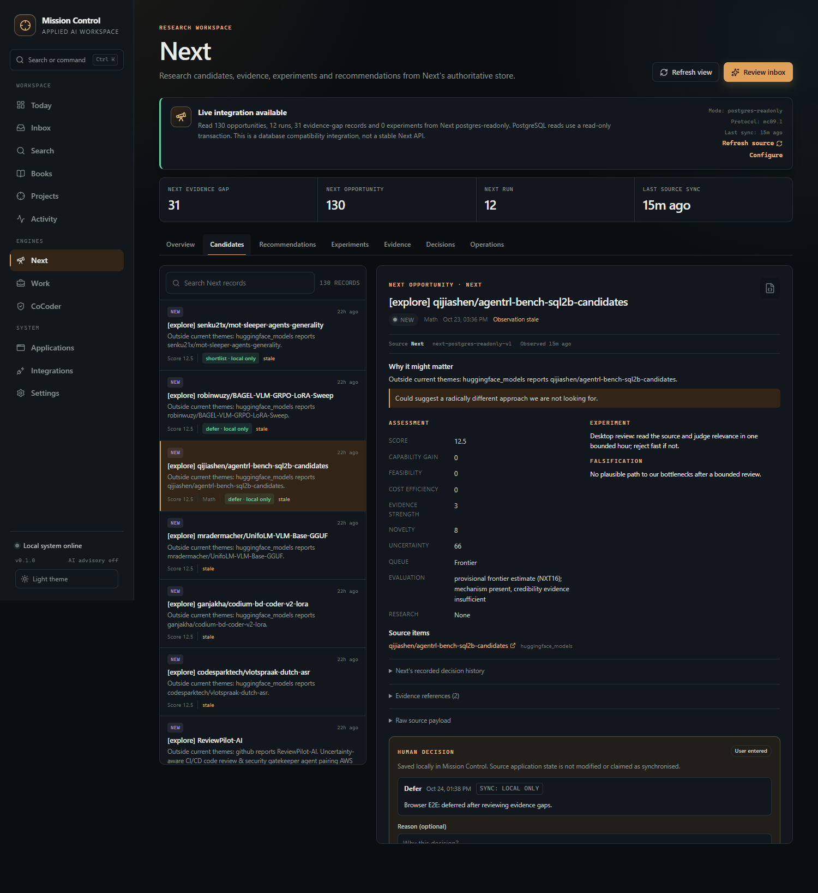

- Overview: [01-next-overview.png](mc09/01-next-overview.png)
- Candidate list: [01b-next-candidates.png](mc09/01b-next-candidates.png)
- Evidence: [browser-e2e.json](mc09/browser-e2e.json), `next_candidates`

### Work

The browser opened `/work`, filtered 130 opportunities down to 2 matching
"Support and Maintenance", inspected a qualified opportunity, verified buyer,
location, qualification score, blockers, evidence mode and compensation caveat,
and confirmed its local shortlist + Math association. A second qualified
opportunity was then opened and an **Investigate** decision was recorded through
the UI. Source state stayed `DISCOVERED / qualified`; the decision stayed
`local_only`.

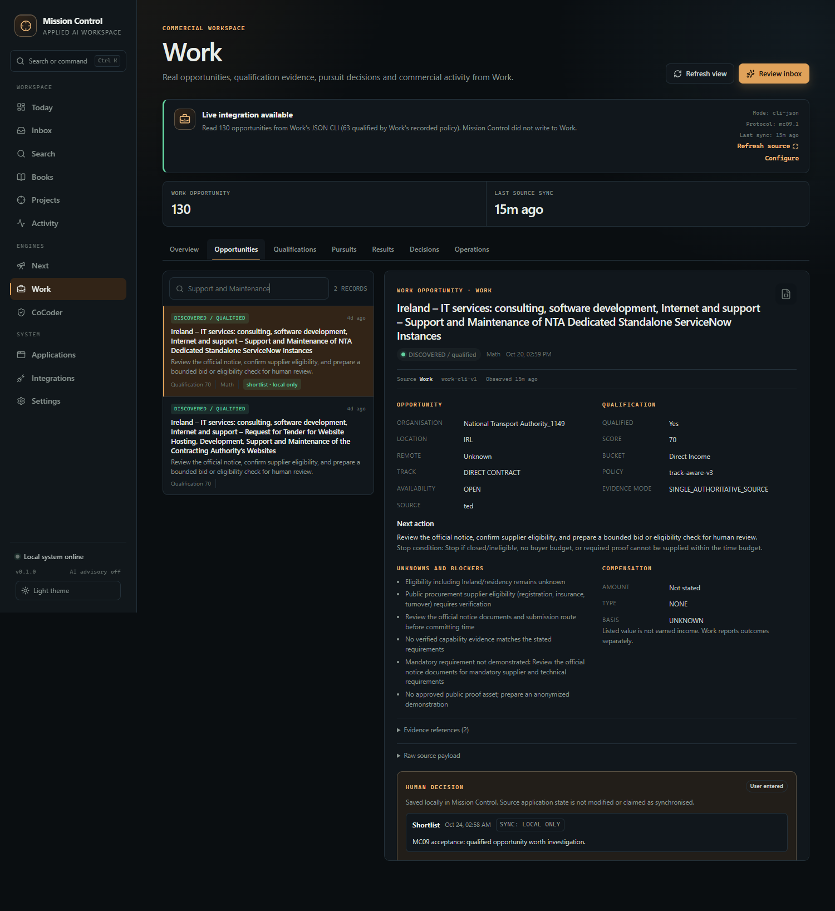
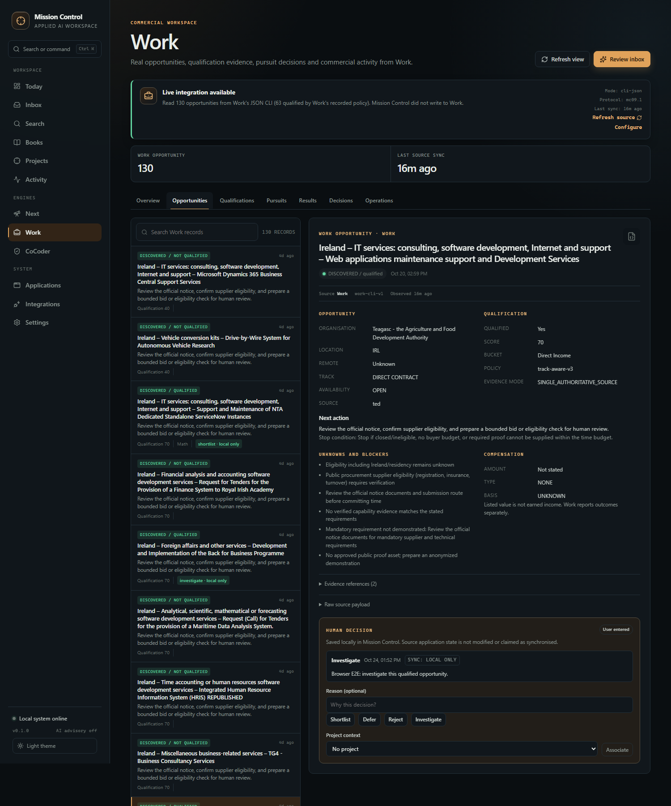

The Results view explicitly states that verified payments/outcomes are not
available from the read-only export. No income was inferred.

### CoCoder

The browser opened `/cocoder`, filtered 400 retained findings to 12 high-severity
"Exception handling widened" findings, inspected repository, revision range,
artifact, affected path, evidence and unknowns, and recorded an **Investigate**
decision through the UI. Acknowledging a finding is not presented as code
verification.

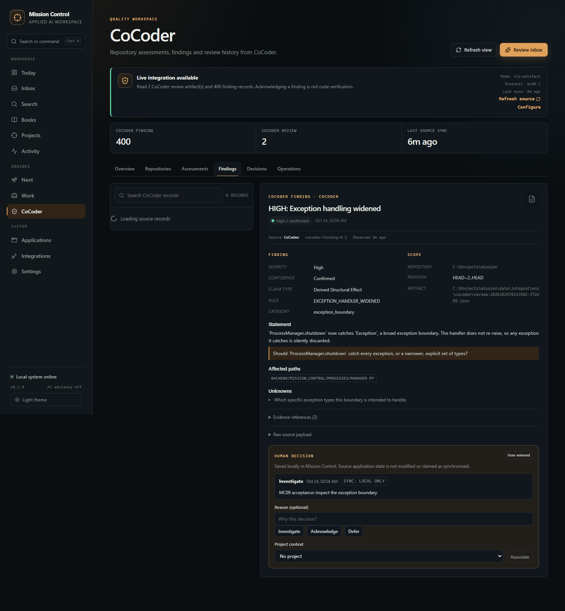
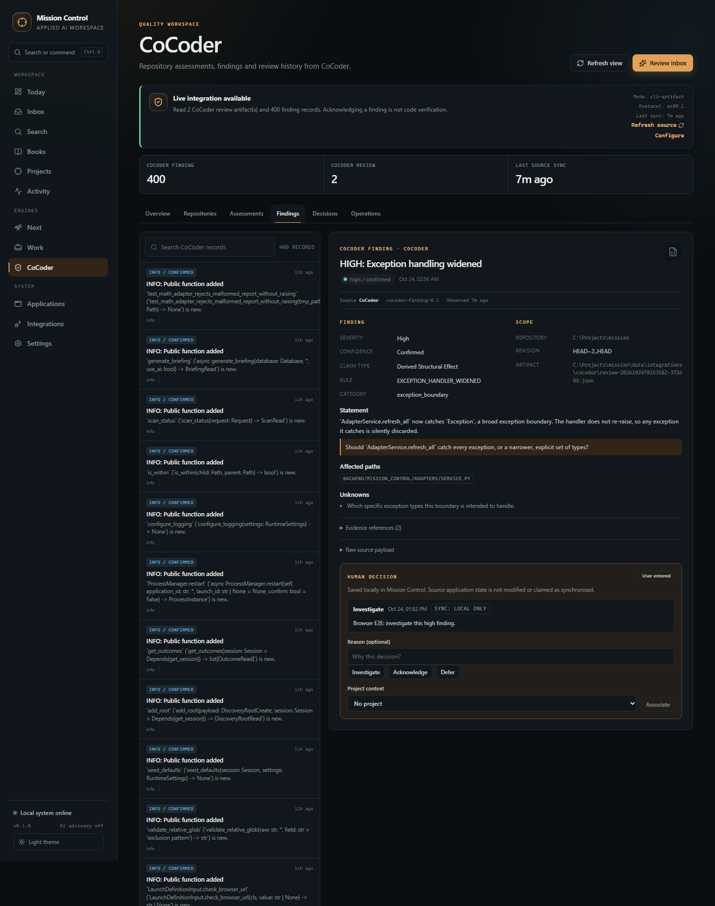

Two real reviews were launched through Mission Control:

| Review | Range | Changed files | Findings | Duration |
| --- | --- | --- | ---: | ---: |
| Full Mission Control range | `HEAD~2..HEAD` | 146 | 478 (400 retained) | 160.7 s |
| State-isolation verification | `HEAD~1..HEAD` | 5 | 0 | 33.1 s |

Both execution records are durable and succeeded. Artifacts are under
`data/integrations/cocoder/`. CoCoder's internal SQLite/artifacts are redirected
to `data/integrations/cocoder/engine/`; a real review created **no `.cocoder`
directory** in the reviewed repository.

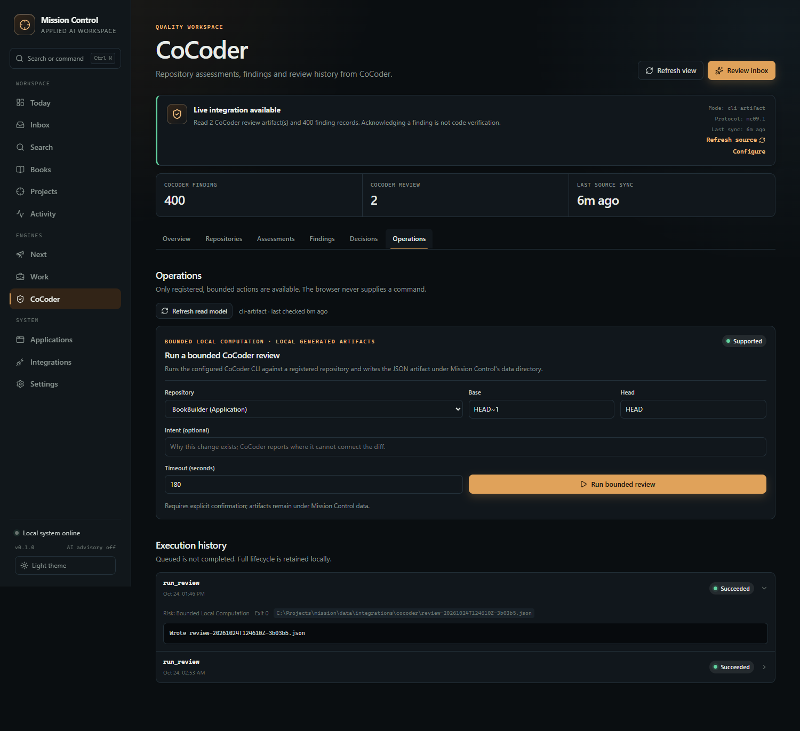

### Unified inbox

45 pending items were shown: 15 from each of Next, Work and CoCoder. Source pills,
priority, project, evidence, observed time and available decisions remain
distinct. Filtering to CoCoder worked; opening an item navigated to its functional
detail (`/work?record=...` in the acceptance run).

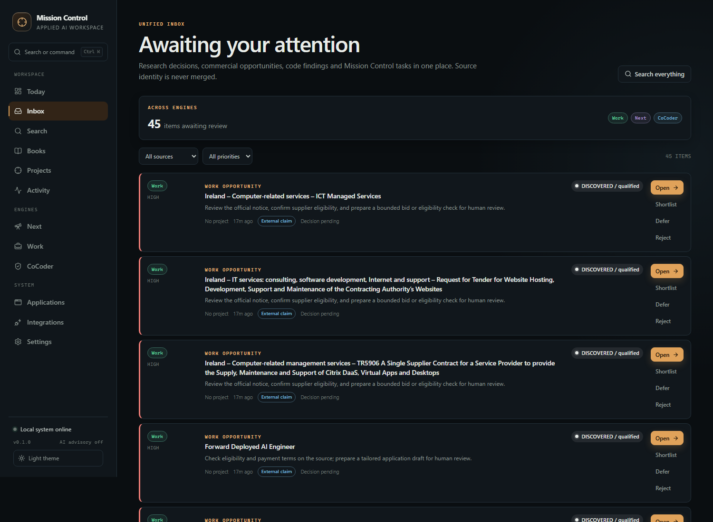
- Full inbox: [06-unified-inbox.png](mc09/06-unified-inbox.png)
- CoCoder filter: [06b-inbox-cocoder-filter.png](mc09/06b-inbox-cocoder-filter.png)

### Search

`agent` returned 100 results across **Next (91)** and **Work (9)**. `exception`
returned CoCoder findings and Work records. Results preserve source attribution
and open inside Mission Control.

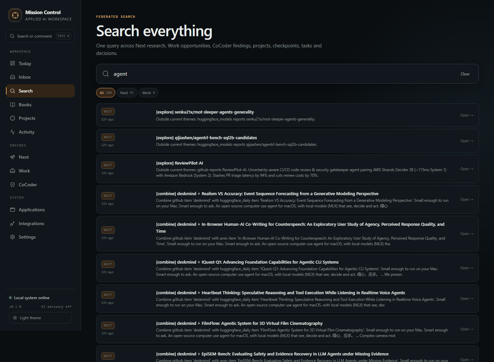
- Full result list: [07-search-cross-source.png](mc09/07-search-cross-source.png)

### Command palette

`Ctrl+K` opened the palette. `exception` returned CoCoder findings with source and
statement; navigation and available refresh commands are capability-filtered.
Escape closed the palette.

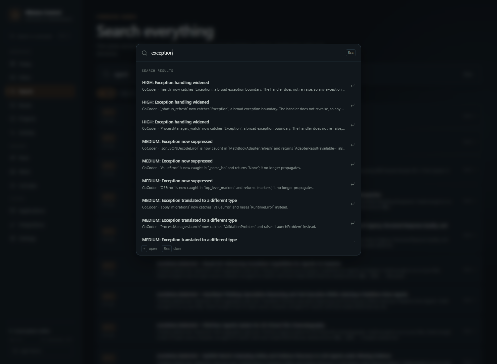

### Shared project context

The Math project showed two associated application records: a Next candidate with
a local defer decision and a Work opportunity with a local shortlist decision.
Source systems remain authoritative; Mission Control stores only the association
and its read model.

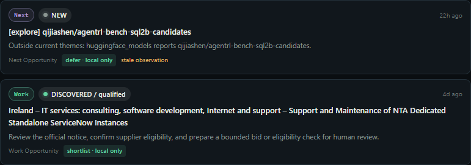

### Integrations

The Integrations page showed all three engines connected, their modes
(`postgres-readonly`, `cli-json`, `cli-artifact`), protocol `mc09.1`, capabilities,
record counts, last sync, configuration summary and registered actions. The Next
and Work write actions display explicit blocked reasons.

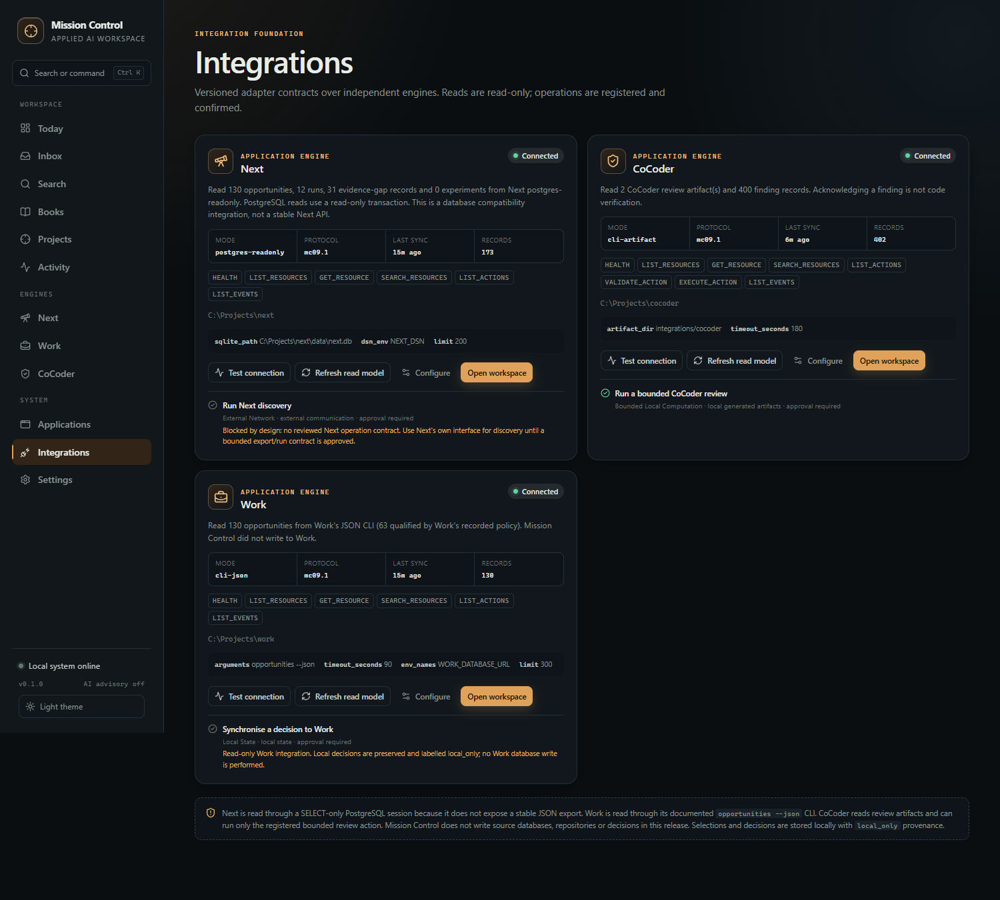

## Persistence

The backend was restarted during acceptance. The following survived:

- Next local decisions and Math association;
- Work local shortlist and Math association;
- CoCoder local investigate decision;
- integration configuration and cached read models;
- CoCoder artifacts, engine state and execution history;
- schema migrations 001 and 002.

Nine decisions are stored (3 Next, 3 Work, 3 CoCoder), all `local_only`.
No source application state changed.

## Failure isolation

- Before any CoCoder artifact existed, the live CoCoder workspace showed an
  unavailable integration with the correct diagnostic while Next and Work stayed
  operational.
- Automated test `test_failed_source_refresh_does_not_break_other_workspaces`
  points Work at a missing executable, verifies `available=false`, and confirms
  Next resources, the inbox and health remain available.
- Adapter errors are contained; no dashboard crash occurred during acceptance.
- CoCoder review failure would be recorded as a failed execution with output and
  error, not a completed action.

## Security verification

Browser-originated attempts were made against the live server:

| Attempt | Result |
| --- | --- |
| Review `C:\Windows` (unregistered repository) | **422** `repo_path is not a registered repository` |
| Review with injected `command` parameter | **422** `Unknown action parameters: command` |
| Review without explicit confirmation | **409** conflict |
| Execute disabled Next discovery action | **409** `capability_unavailable` |
| Executions before/after rejected attempts | 2 / 2 - nothing queued |

The browser cannot submit an executable, command line, working directory or
unregistered repository. Parameter schema, adapter validation and registration
checks all run before an execution is created.

Full evidence: [security-check.json](mc09/security-check.json).

## Tests, build and performance

| Check | Result |
| --- | --- |
| Backend pytest | **50 passed** |
| Backend ruff | passed |
| Frontend Vitest | **23 passed** across 9 files |
| Production build | passed (441.98 kB JS, 66.93 kB CSS) |
| Browser E2E | **17 steps passed** |
| Browser console errors | **0 unexpected** (4 expected 422/409 network logs from security tests) |
| Browser page errors | **0** |

Browser timing from navigation to required content (local headless Chrome):

| View | Time |
| --- | ---: |
| Next overview | 619 ms |
| Next candidates | 827 ms |
| Work opportunities | 1,152 ms |
| CoCoder findings | 1,930 ms |
| CoCoder operations | 454 ms |
| Unified inbox | 1,449 ms |
| Cross-source search | 948 ms |
| Command palette search | 478 ms |
| Project context | 292 ms |
| Integrations | 374 ms |

Live adapter refresh timings:

- Next read-only PostgreSQL: 0.23 s.
- Work CLI JSON: 0.61 s.
- CoCoder review: 160.7 s (full), 33.1 s (small).

Evidence files:

- [backend-tests-mc09.txt](backend-tests-mc09.txt)
- [frontend-tests-mc09.txt](frontend-tests-mc09.txt)
- [frontend-build-mc09.txt](frontend-build-mc09.txt)
- [ruff-mc09.txt](ruff-mc09.txt)
- [browser-e2e.json](mc09/browser-e2e.json)
- [runtime-state.json](mc09/runtime-state.json)
- [openapi-mc09.json](openapi-mc09.json)

## Success metrics

| Metric | Result |
| --- | --- |
| Workflows completed entirely inside Mission Control | Next browse/inspect/decide/associate; Work filter/inspect/decide; CoCoder inspect/decide/launch review; inbox; search; project context |
| External dashboards required for these workflows | 0 |
| Manual application switches | 0 (workspace navigation only) |
| Supported interactive operations | 2 registered actions (1 enabled, 1 intentionally blocked); refresh/read actions |
| Available adapters | 3 of 3 |
| Action completion | 2 succeeded / 2 attempted real reviews; 0 failed |
| Data freshness | explicit last-sync display; Next 0.23 s and Work 0.61 s refresh |
| Human decisions preserved | 9, all `local_only`, across a backend restart |

## Missing capabilities

1. **Next export contract** - no stable JSON resource API. The current read-only
   database integration is explicitly a compatibility path.
2. **Next bounded operation** - discovery can fetch the network, call models and
   write Next's store. It remains disabled.
3. **Work decision write contract** - `work decide` writes authoritative state;
   no approved synchronisation contract exists, so decisions remain local.
4. **Work outcomes** - the read-only CLI export does not contain verified
   payments/income.
5. **CoCoder cancellation/streaming** - execution is bounded and durable, but
   cannot yet be cancelled from the UI or stream logs live.
6. **CoCoder finding cap** - 400 findings per artifact are retained to bound the
   read model.
7. **Other engines** - Writer, Worker, Improve, BookBuilder, Stephanie and
   Workbench remain outside MC09.

## Proposed MC10 plan

### P0 - Stable source contracts

- Specify and approve `next-research-export-v1`; implement a versioned read-only
  export in Next only after authorisation.
- Specify `work-decision-v1` and an idempotent read/write contract for Work.
- Freeze CoCoder artifact schema `0.2` fields used by Mission Control and add a
  machine-readable compatibility version.

### P1 - Action hardening

- Add cancellation and streaming execution output.
- Add idempotency keys and explicit per-action concurrency policy.
- Add a review/approval dialog that shows exact repository, refs, timeout and
  expected side effects before confirmation.
- Add scheduled/queued actions only with explicit opt-in.

### P2 - Deeper workflows

- Next: bounded discovery/reassessment operation with approval and job logs.
- Work: synchronise decisions after the write contract is approved, with
  conflict handling and source acknowledgement.
- CoCoder: repository baseline selection, review history comparison and
  resolution tracking without equating acknowledgement with verification.

### P3 - Shared context and coordination

- Project evidence timeline combining Next findings, Work pursuits, CoCoder
  reviews, checkpoints and executions.
- Cross-application next actions with explicit ownership.
- Level 5 workflow: Next finding -> Worker implementation -> CoCoder review,
  with human approval at each boundary.

### P4 - Conversational interface

- Natural-language queries over the federated read model with source citations.
- AI proposes registered commands; it never executes unconstrained commands.
- Approval required for every side-effecting action.

### P5 - Additional engines

- Writer, Worker and the book workspaces through the same `mc09.1`/successor
  contract.
- Do not build new dashboards for each engine; implement its adapter and workspace
  capabilities.

### P6 - Acceptance and operations

- Add Playwright to the repository's dev tooling and run the browser acceptance
  suite in CI/local checks.
- Accessibility audit and keyboard navigation for the command palette.
- Failure injection for every adapter and action.
- Performance checks at 500+ resources and 5,000+ inbox/search records.
- Retention and cleanup for historical integration records and artifacts.

## Remaining dependencies

- Next: externally managed PostgreSQL reachable through `NEXT_DSN`, or the
  configured SQLite snapshot.
- Work: its Python environment/executable and `WORK_DATABASE_URL`.
- CoCoder: its Python environment/executable and a registered Git repository.
- Browser evidence: local Google Chrome; Puppeteer was used from a temporary
  directory and is not a runtime dependency.

## Reproduce

```powershell
# Backend
.venv\Scripts\ruff.exe check backend scripts
.venv\Scripts\python.exe -m pytest -q

# Frontend
cd frontend
npm test
npm run build
cd ..

# Start and configure integrations (values are read by name, never printed)
.\scripts\start.ps1

# Then use Integrations to test/refresh Next, Work and CoCoder.
# CoCoder reviews can be launched from CoCoder > Operations.
```

## Honest limitations

- Next is integrated through a read-only database compatibility layer, not a
  stable Next API. This is visible in the UI and audit.
- Work decisions are local only. The UI never claims that Work was updated.
- CoCoder's full review is expensive and is an explicit action, not a dashboard
  poll.
- Mission Control's state-redirection config uses CoCoder defaults apart from
  `[cqrs]`; repository-local CoCoder configuration is not merged for reviews
  launched from Mission Control.
- Browser E2E uses a temporary Puppeteer installation; it is reproducible but
  not yet part of the repository's committed test dependencies.
- The acceptance run used real local data and real local processes. No fixture
  data is served by production pages.
