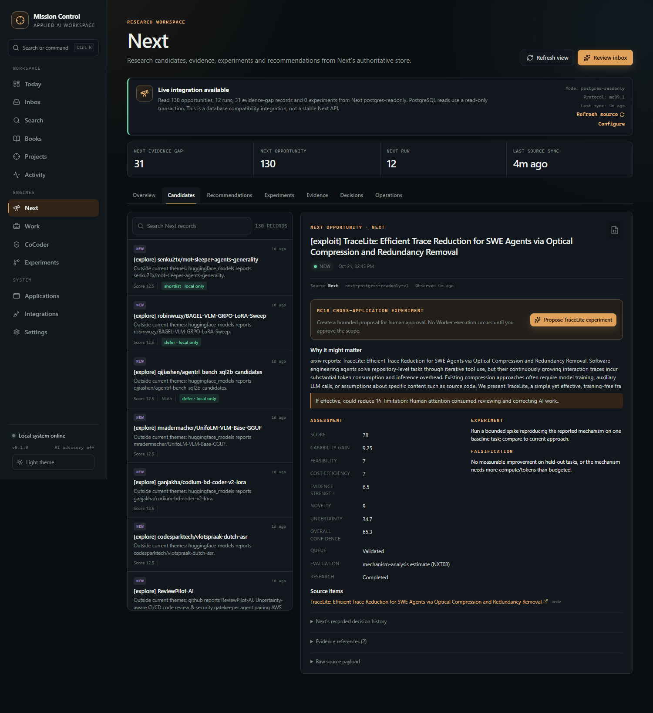
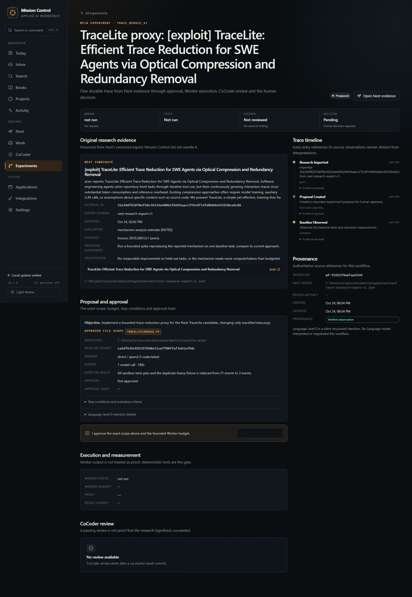
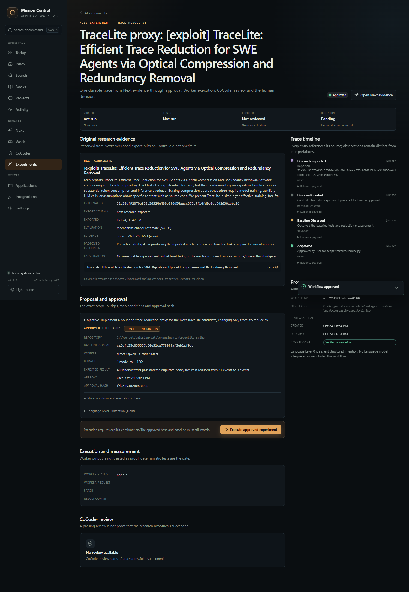
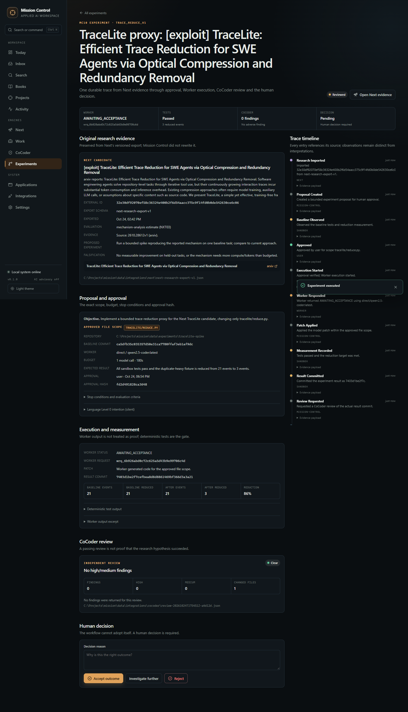
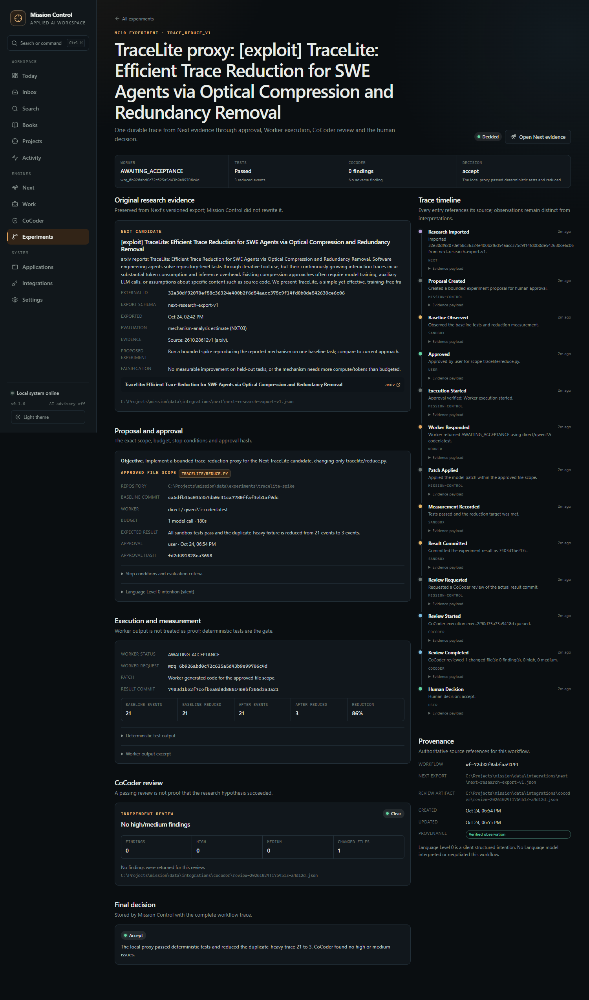
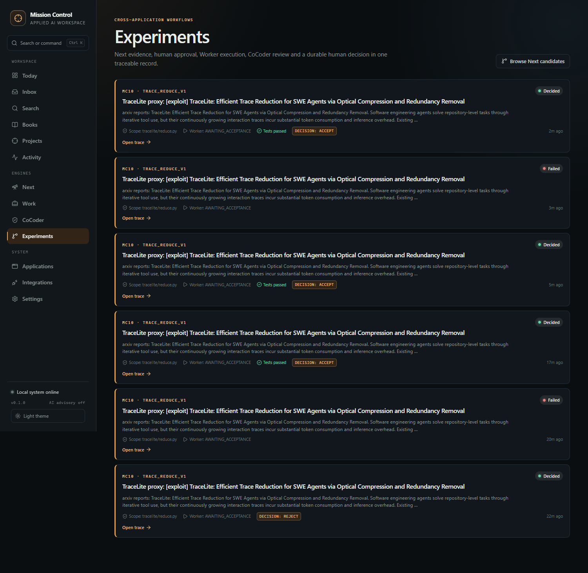

# MC10 - acceptance and engineering report

## Summary

MC10 delivered one real, evidence-preserving cross-application workflow:

```text
Next TraceLite evidence
→ Mission Control proposal
→ human approval of exact scope/budget
→ Worker local execution (qwen2.5-coder via Ollama)
→ approved one-file patch
→ deterministic tests/measurement
→ CoCoder review of the actual commit
→ human accept decision
```

Final accepted workflow: **`wf-72d32f9abfaa4144`**.
Baseline: **21 events / 2 failing tests / 0.0 reduction**.
Outcome: **3 events / 5 passing tests / 85.7% reduction**.
CoCoder: **1 changed file, 0 findings**.
Human decision: **accept**, recorded through the browser UI.

No paid inference was used. No source repository was modified by the workflow.
No push was performed.

## Repository state

| Item | State |
| --- | --- |
| Mission Control | `C:\Projects\mission`, branch `main` |
| MC09 baseline | `da22636` |
| MC10 implementation commit | `0956545` (`Implement MC10 cross-application experiment workflow`) |
| Acceptance evidence commit | this documentation/evidence commit; hash in the final delivery note |
| Next contract commit | `491b501` on `main` (`Add versioned read-only research export contract`), not pushed |
| Worker | `0aecefa`, 33 pre-existing changes preserved, no source change |
| CoCoder | `f4e90d6`, 36 pre-existing changes preserved, no source change |
| Work | `e79e68c`, 1 pre-existing change preserved, no source change |
| Push | **none** |
| Runtime data | `data/` (git-ignored), schema migrations 001 + 002 + 003 |

## Phase results

### Phase 0 - reality audit

Verified baseline: 50 backend tests, 23 frontend tests, live MC09 service.
Audited Next, Worker, CoCoder and Work. Full detail:
[MC10-REALITY-AUDIT.md](../MC10-REALITY-AUDIT.md).

### Phase 1 - stable research contract

Added `next-research-export-v1`, owned by Next:

```powershell
python -m next export --output FILE --limit 200
```

- 2 source-side tests passed.
- Live export: 130 opportunities, 12 runs, 130 decisions, 1,082,976 bytes.
- TraceLite identity, evidence, mechanism fields, proposed experiment,
  falsification and source item survived into the workflow.
- Mission Control's MC09 read-only PostgreSQL adapter remains available.
- Limitation: Next's export uses Next's own store constructor, which may apply
  Next schema initialization/migrations; it modifies no research rows. A
  no-migrate export mode is a follow-up.

### Phase 2 - bounded execution

Worker's documented HTTP interface (`POST /v1/work`) was used with its `direct`
executor pointed at a local Ollama OpenAI-compatible endpoint. The proposal
contains repository, baseline, exact scope, one-model-call budget, timeout,
expected result, stop conditions and evaluation criteria.

Approval requires explicit confirmation plus scope acknowledgement. Execution
rechecks the approval hash, baseline HEAD, approved file hash and clean sandbox.
A changed scope, baseline or file is rejected as a stale approval.

Worker returned `AWAITING_ACCEPTANCE`; MC10 does not claim Work Evidence or
Acceptance from this lower-semantics executor. Deterministic tests are the gate.

### Phase 3 - independent review

CoCoder reviewed the actual `ca5dfb3..7403d1b` diff. The review artifact records
one changed file (`tracelite/reduce.py`) and zero findings. A passing review is
not represented as proof of the research hypothesis.

### Phase 4 - evidence timeline

Thirteen durable events:

1. research imported
2. proposal created
3. baseline observed
4. approved
5. execution started
6. Worker responded
7. patch applied
8. measurement recorded
9. result committed
10. review requested
11. review started
12. review completed
13. human decision

Every event has a source, timestamp, summary and evidence payload. The workflow
also stores the silent Language Level 0 intention.

### Phase 5 - operational UI

- `/workflows` lists experiment traces and outcomes.
- `/workflows/:id` shows original research evidence, scope/budget, approval hash,
  Worker execution, baseline/outcome measurements, CoCoder findings, complete
  timeline and the human decision.
- Next's TraceLite candidate exposes a **Propose TraceLite experiment** button.
- Approval, execution and decision were all exercised in the browser.

## Acceptance proof

| # | Requirement | Evidence |
| --- | --- | --- |
| 1 | Original research evidence survives | Workflow `next_evidence` contains the `next-research-export-v1` candidate and source item; rendered in UI |
| 2 | Approved scope cannot silently expand | Scope is exactly `tracelite/reduce.py`; AST/scope enforcement and `test_scope_expansion...`; real diff is one file |
| 3 | Worker produces an observable result | Worker request `wrq_6b926abd0c72c625a5d43b9e99706c4d`; local model output stored with SHA-256; patch applied |
| 4 | CoCoder reviews the actual result | Artifact `review-20261024T175451Z-a4d12d.json`; base/head records; one changed file, 0 findings |
| 5 | Mission Control records complete history | 13 workflow events plus proposal, approval, execution, measurement, review and decision records |
| 6 | Replay creates no duplicates | Browser E2E replayed execute and create; same Worker request, result commit and workflow id; backend idempotency test |
| 7 | Failure/interruption reported accurately | Failed workflows preserve exact errors; early model/test failure was rejected, not hidden; unit test covers Worker failure |
| 8 | Adverse review prevents automatic adoption | Backend adverse-review test; UI keeps Accept disabled until explicit override; override requires reason |
| 9 | No unauthorised changes or paid inference | Real diff one approved file; local Ollama only; no paid route configured; source repos unchanged |
| 10 | User can inspect/decide in Mission Control | Browser E2E approved, executed, reviewed and accepted `wf-72d32f9abfaa4144` |

## Real execution evidence

| Field | Value |
| --- | --- |
| Workflow | `wf-72d32f9abfaa4144` |
| Next candidate | `32e30df92070ef58c36324e400b2f6d54aacc375c9f14fd0b0de542630ce6c06` |
| Scope | `tracelite/reduce.py` |
| Baseline commit | `ca5dfb35c035357d50e31ca7780ffaf3eb1af9dc` |
| Result commit | `7403d1be2f7cefbea8d8d8861469bf366d3a3a21` |
| Worker request | `wrq_6b926abd0c72c625a5d43b9e99706c4d` |
| Worker status | `AWAITING_ACCEPTANCE` (honest lower-semantics output) |
| Worker model | `qwen2.5-coder:latest` via local Ollama |
| Baseline tests | 3 passed, 2 failed |
| Outcome tests | 5 passed |
| Baseline trace | 21 events → 21 (ratio 0.0) |
| Outcome trace | 21 events → 3 (ratio 0.8571) |
| CoCoder artifact | `review-20261024T175451Z-a4d12d.json` |
| CoCoder findings | 0 high / 0 medium / 0 low / 0 info |
| Decision | accept (UI) |
| Workflow span | 23.24 s (approval to decision 14 s) |

### Failed and exploratory attempts

The report does not hide failed attempts:

- `wf-7bdb167746664a39` — true baseline; model appended the last event twice;
  tests failed; measurement 21 → 4; human rejected.
- `wf-b53bf11c526b4209` — model JSON patch was malformed; rejected before writing.
- `wf-95ec73f2ed6644fc` — model wrapped code in commentary; parser rejected it
  before writing.
- `wf-cae5173ef54444af` — early UI smoke on an already-patched sandbox baseline;
  not used as acceptance evidence. This exposed the baseline-reset gap.
- The sandbox now tags `mc10-baseline`, tags each result commit, and resets a
  new attempt to the original baseline. `wf-72d...` is the final true-baseline run.

This is why the final report distinguishes "the UI worked" from "the experiment
started from an honest baseline".

## Tests and performance

| Check | Result |
| --- | --- |
| Mission Control backend | **53 passed** |
| Mission Control frontend | **26 passed** across 10 files |
| Production build | passed (461.09 kB JS, 73.95 kB CSS) |
| Ruff | passed |
| Next export tests | **2 passed** |
| Worker gateway tests | **210 passed, 8 skipped, 0 failed** |
| Browser E2E | **5 steps passed**, 0 console errors, 0 page errors |
| Next live export | 130 opportunities, 12 runs, 130 decisions, 0.7 s |
| Worker local call | ~1.2 s after model load |
| CoCoder review | ~10.1 s for one file, 0 findings |
| Full workflow | 23.2 s including approval, execution, review and decision |

Evidence:

- [Backend tests](backend-tests-mc10.txt)
- [Frontend tests](frontend-tests-mc10.txt)
- [Frontend build](frontend-build-mc10.txt)
- [Ruff](ruff-mc10.txt)
- [Next export tests](next-export-tests-mc10.txt)
- [Worker gateway tests](worker-gateway-tests-mc10.txt)
- [Browser E2E](mc10/browser-e2e.json)
- [Runtime state](mc10/runtime-state.json)
- [Source repository state](mc10/source-repositories.txt)
- [OpenAPI](openapi-mc10.json)

## Screenshots








## Security verification

- Approved scope is one path; extra-file patches are rejected before writing.
- Generated Python is AST-validated; imports, dunder attributes and dangerous
  calls are rejected.
- Approval hash covers the exact objective, scope, repository, baseline, file
  hash, Worker config and prompt.
- Execution rejects stale approval, changed baseline/file and a dirty sandbox.
- New attempts reset to the tagged baseline; prior result commits are tagged.
- CoCoder high/medium findings block accept unless the human explicitly overrides
  with a reason.
- No paid inference route was configured. Worker called local Ollama.
- No source repository was written by the workflow.
- The browser sends workflow IDs and typed decisions, not commands or paths.

## Honest limitations

- Worker `direct` is lower-parity: no Work Evidence, Verify, Proof or Acceptance.
- The experiment is a proxy spike, not the full TraceLite mechanism.
- Generated code runs in a dedicated sandbox/test subprocess, not a hard OS
  sandbox. Static AST checks, fixed scope and a timeout are the current controls.
- Next's export command may apply Next schema initialization because it uses the
  source-owned store constructor; no research rows were changed.
- One model call can fail or produce malformed output; failed attempts are
  preserved and require a new workflow.
- No Worker cancellation/streaming events yet.
- One registered workflow template only.
- Work write-back, Writer, Movies and unrestricted conversational autonomy were
  not implemented.

## Proposed MC11

1. **Worker parity** — run the same workflow through `opencode-work` with a
   supported local/free model route; retain Evidence, Verify, Proof and
   Acceptance identities where possible.
2. **General workflow registry** — multiple bounded experiment templates with
   explicit parameter schemas, rather than one hard-coded TraceLite template.
3. **Approval and execution hardening** — cancellation, streaming events,
   idempotency keys, retry policy and per-action concurrency.
4. **Sandbox hardening** — container/OS isolation for generated code, resource
   quotas, network denial and artifact retention policy.
5. **Next export service** — no-migrate export mode, versioned HTTP endpoint and
   freshness/ETag handling.
6. **Shared project context** — attach workflows to projects and show them in the
   project evidence timeline.
7. **Level 5 coordination** — Next → Worker → CoCoder → human, with Writer or
   other engines only where a concrete dependency is demonstrated.
8. **Language Level 1** — interpret and negotiate `language.intention.v0` only
   after the Level 0 workflow is stable; no unconstrained execution.
9. **Committed browser automation** — move the current temporary Chrome harness
   into the repository test tooling with failure injection.
10. Keep Work write-back, Movies and autonomous publishing outside until their
    contracts and approvals are explicit.

## Reproduce

```powershell
# Next export
C:\Projects\next\.venv\Scripts\python.exe -m next export `
  --output C:\Projects\mission\data\integrations\next\next-research-export-v1.json `
  --limit 200

# Mission Control tests
.venv\Scripts\ruff.exe check backend scripts
.venv\Scripts\python.exe -m pytest -q
cd frontend; npm test; npm run build; cd ..

# Worker direct executor (local Ollama)
# worker-config.json is under data/integrations/worker; start Worker with
# WORKER_CONFIG pointing to it, then use Experiments in the dashboard.
```

The accepted workflow remains inspectable at
`/workflows/wf-72d32f9abfaa4144`.
